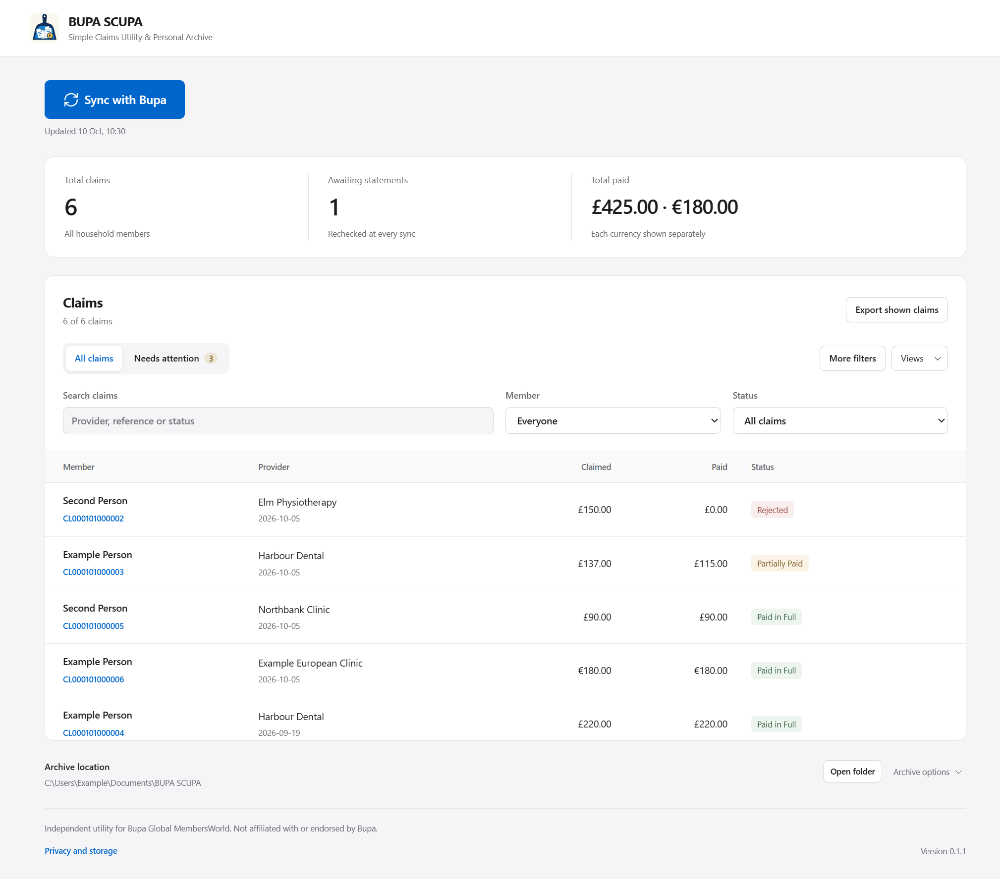

# BUPA SCUPA

Simple Claims Utility & Personal Archive — a free, open-source Windows app for
your household's **Bupa Global MembersWorld** claims.

Download statements, track payments, search and filter claims, and export CSV.
Your PDFs and claim history stay in an archive on your computer.



## Get started

Requires Windows 10/11 x64 and Microsoft Edge or Google Chrome.

[Download the portable EXE](https://github.com/alanmosely/bupa-scupa/releases/latest/download/bupa-scupa-x64.exe)
or [get the ZIP from the latest release](https://github.com/alanmosely/bupa-scupa/releases/latest).
Open the EXE, or extract the ZIP and run `BUPA SCUPA.exe`.

1. Choose an archive folder or keep the default `Documents/BUPA SCUPA`.
2. Click **Sync with Bupa**, sign in and complete MFA in the browser.
3. Confirm your household and each member's first import. Keep both windows open
   until sync finishes.

Browse saved claims offline, filter by member or status, and open the original PDFs.
Back up your archive regularly.

Version 0.3.1 includes claim details, personal follow-ups and saved views, plus
the import and recovery improvements described below.

Select a claim to see its dates, invoice number, payment recipient, benefit category
and current PDFs. Expand **Your follow-up** to add personal notes, the date you last
chased Bupa and a next follow-up date. **Needs attention** gathers awaiting statements, rejected
and partially paid assessments, plus claims you pin or schedule.

Open **More filters** for provider and received, treatment or payment dates, plus
additional sorting. You can also sort with the column headings. The **Views** menu
lets you save and reuse these settings for this archive.
**Export shown claims** exports the current results in the same order.

## Version 0.3.1

Version **0.3.1** fixes mixed duplicate payments, session expiry between members,
related multi-claim PDF links and changed assessment reasons. It also corrects
labelled final invoice amounts and assessments containing several invoices, and
recognises more readable supporting receipts and order confirmations.

Recognised Bupa statements import automatically. Interrupted PDF downloads can
resume for 24 hours, and only documents needing attention are held back.
This is a stable release. The binaries are unsigned, and a fresh packaged live
sync remains an outstanding acceptance check. See the
[release notes](https://github.com/alanmosely/bupa-scupa/releases/tag/v0.3.1).

Version-specific downloads:
[portable EXE](https://github.com/alanmosely/bupa-scupa/releases/download/v0.3.1/bupa-scupa-x64.exe),
[application ZIP](https://github.com/alanmosely/bupa-scupa/releases/download/v0.3.1/bupa-scupa-0.3.1-x64.zip),
[source](https://github.com/alanmosely/bupa-scupa/releases/download/v0.3.1/bupa-scupa-0.3.1-source.zip),
and [checksums](https://github.com/alanmosely/bupa-scupa/releases/download/v0.3.1/SHA256SUMS.txt).

## Agents and scripts

Agents can query claims and payment totals through the [local JSON API](AGENT_API.md).
From a source checkout:

```powershell
node src/agent.js report --data-dir "D:\PrivateArchive"
```

Use `schema` to discover commands, `status` to inspect the archive, and `claims`
for individual records. Commands return JSON.

## Documentation

- [Archive and backups](docs/ARCHIVE.md) · [Privacy](PRIVACY.md)
- [Contributing](CONTRIBUTING.md) · [Architecture](docs/ARCHITECTURE.md)
- [Security](SECURITY.md)

To run from source with Node.js 22.13+: `npm ci`, `npm run vendor`, then `npm start`.

Independent project, not affiliated with or endorsed by Bupa.
Licensed under [GPL-3.0-or-later](LICENSE). See [third-party notices](NOTICE).
