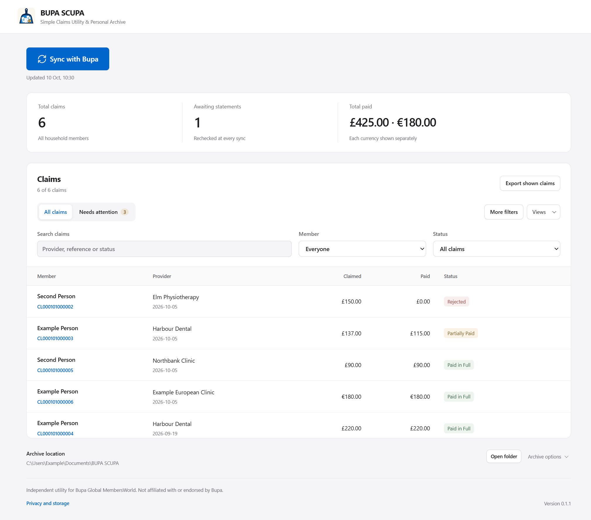

# BUPA SCUPA

Simple Claims Utility & Personal Archive — a free, open-source Windows app for
your household's **Bupa Global MembersWorld** claims.

Download statements, track payments, search and filter claims, and export CSV.
Your PDFs and claim history stay in an archive on your computer.



## Get started

Requires Windows 10/11 x64 and Microsoft Edge or Google Chrome.

[Download the portable EXE](https://github.com/alanmosely/bupa-scupa/releases/latest/download/bupa-scupa-x64.exe)
or [get the ZIP from the latest release](https://github.com/alanmosely/bupa-scupa/releases/latest).
Open the EXE, or extract the ZIP and run `BUPA SCUPA.exe`.

1. Choose an archive folder or keep the default `Documents/BUPA SCUPA`.
2. Click **Sync with Bupa**, sign in and complete MFA in the browser.
3. Confirm your household and each member's first import. Keep both windows open
   until sync finishes.

Browse saved claims offline, filter by member or status, and open the original PDFs.
Back up your archive regularly.

SCUPA includes claim details, personal follow-ups and saved views.

Select a claim to see its dates, invoice number, payment recipient, benefit category
and current PDFs. Expand **Your follow-up** to add personal notes, the date you last
chased Bupa and a next follow-up date. **Needs attention** gathers awaiting statements, rejected
and partially paid assessments, plus claims you pin or schedule.

Open **More filters** for provider and received, treatment or payment dates, plus
additional sorting. You can also sort with the column headings. The **Views** menu
lets you save and reuse these settings for this archive.
**Export shown claims** exports the current results in the same order.

## Version 0.3.3

Interrupted archive recovery can be retried after its owner has stopped. If a
change report cannot be written after claims are saved, SCUPA now confirms the
saved changes and retains the report for a later retry. Rechecking saved PDFs
recovers that report without importing the same claims again.

Statement parsing keeps padded claim headings separate and refuses malformed
amounts or inconsistent conversion totals. Member-page navigation uses
cancellable retries, and linked files or folders cannot bypass archive boundaries.
Concurrent portable launches also keep their extracted application files separate.

Back up the entire archive and close SCUPA before replacing the application.
Older recovery guards without owner information still require the documented
manual recovery. The binaries are unsigned, and a fresh packaged live sync
remains outstanding. See the [release and upgrade notes](docs/RELEASE_NOTES_0.3.3.md).

## Updating an existing archive

1. Back up your **entire archive folder**, including its PDFs, claim history and
   personal follow-up notes.
2. Close SCUPA, download the latest release and replace the old application. For
   the ZIP, extract the complete application into a new folder.
3. Open the updated app with your existing archive, then choose
   **Archive options → Recheck saved PDFs**.

Rechecking applies the parsing fixes to saved statements, refreshes assessment
reasons and builds links to related statements saved under another claim. It
works offline and needs no Bupa login or new downloads. Your saved PDFs and
personal follow-up notes are preserved. Use **View changes** after the recheck
to see any corrected records. Claims with no saved assessment statement still
need a future sync to check for one.

## Agents and scripts

Agents can query claims and payment totals through the [local JSON API](AGENT_API.md).
From a source checkout:

```powershell
node src/agent.js report --data-dir "D:\PrivateArchive"
```

Use `schema` to discover commands, `status` to inspect the archive, and `claims`
for individual records. Commands return JSON.

## Documentation

- [Archive and backups](docs/ARCHIVE.md) · [Privacy](PRIVACY.md)
- [Contributing](CONTRIBUTING.md) · [Architecture](docs/ARCHITECTURE.md)
- [Security](SECURITY.md)

To run from source with Node.js 22.13+: `npm ci`, `npm run vendor`, then `npm start`.

Independent project, not affiliated with or endorsed by Bupa.
Licensed under [GPL-3.0-or-later](LICENSE). See [third-party notices](NOTICE).
